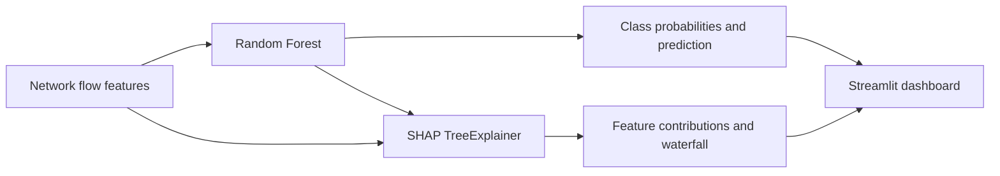
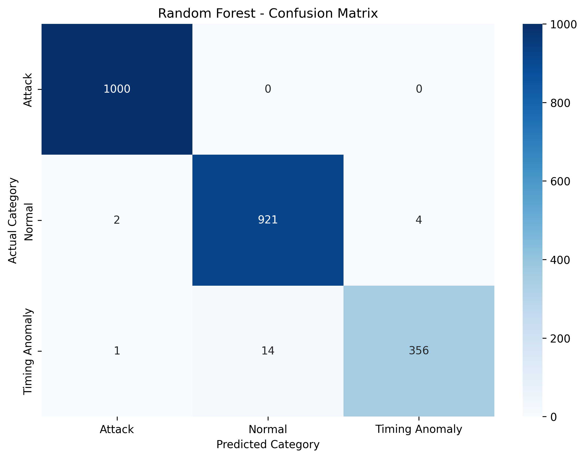
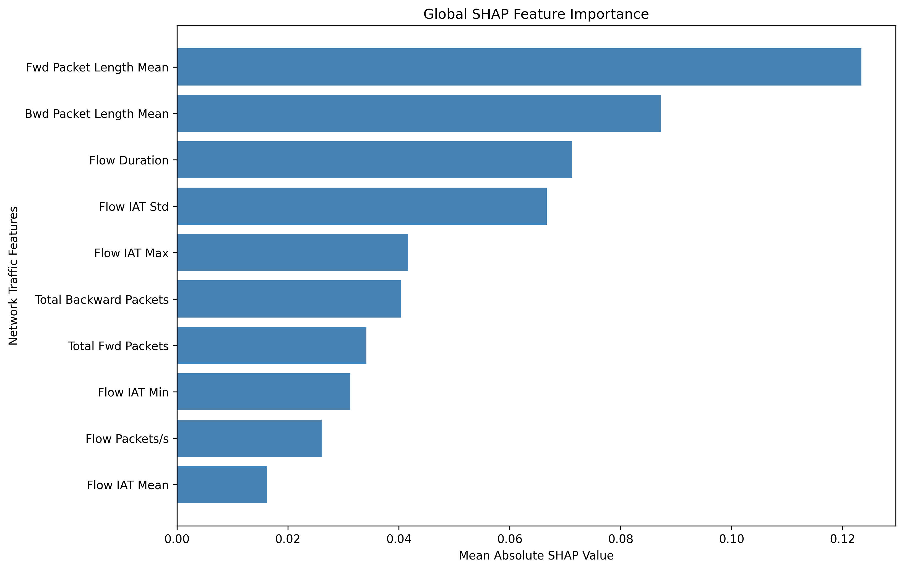
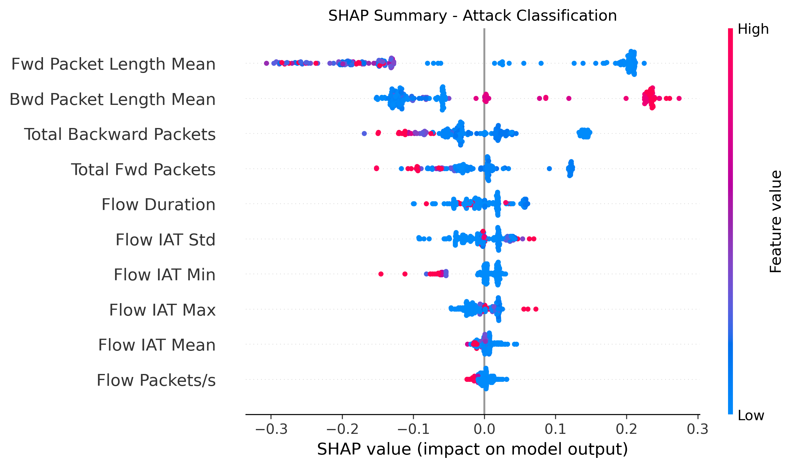
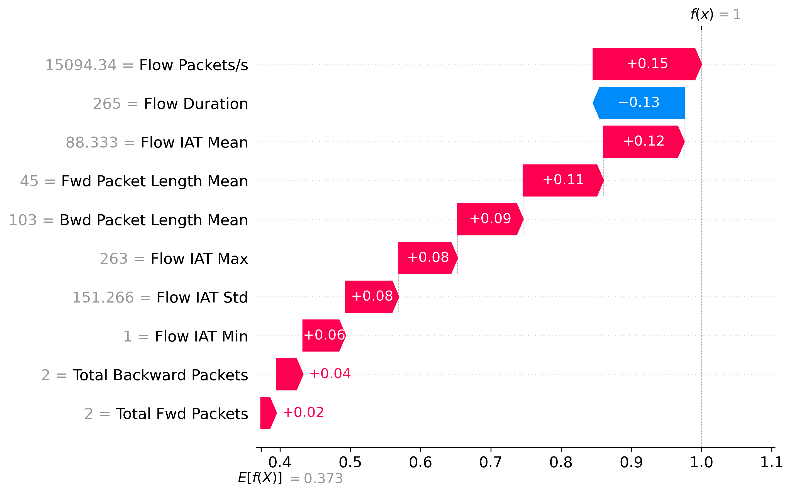

# 6G-XAI Sentinel

**Explainable intelligence for next-generation network security**

  

## Overview

6G-XAI Sentinel is an interactive Streamlit proof of concept developed for the final year project **Explainable AI (XAI)-Driven Framework for Protocol Anomaly Classification and Identification in 6G-Communication Networks**. It classifies numerical network-flow features into Normal, Attack or Timing Anomaly and generates a local SHAP explanation for the predicted class.

The system uses CICIDS2017 as a conventional network traffic benchmark, augmented with simulated timing anomalies. It is not a live 6G intrusion detection system.

## Application features

| Page | Function |
|---|---|
| Overview | Experimental metrics, class recall and dataset statistics |
| Classify & Explain | 15 held-out examples or custom inputs; on-demand predictions, class probabilities, SHAP contributions and waterfall plot |
| Explainability | Saved global importance, Attack beeswarm and local waterfall graphs |
| Evaluation | Confusion matrix and per-class classification report |
| About | Methodology and research limitations |

## Quick start

Open the deployed Streamlit application using the link supplied by the project owner. Select **Classify & Explain**, choose a traffic example or **Custom input**, review the ten numeric fields and click **Classify & Explain**. Inspect the predicted category, probabilities, ranked feature contributions and waterfall chart. No dataset download or model retraining is required.

## Run locally

Use Python 3.13 (the original training environment used Python 3.13.18). From the repository root, run:

```bash
python -m venv .venv
# Windows PowerShell:
.venv\Scripts\Activate.ps1
# macOS/Linux alternative: source .venv/bin/activate
python -m pip install -r requirements.txt
python -m streamlit run app.py
```

Open the local address printed in the terminal. Load only the trusted model artifact supplied with this project; pickle/joblib files from untrusted sources can execute code.

## Deployment

In Streamlit Community Cloud, select this GitHub repository, its deployment branch (normally `main`), and `app.py` as the main file. Choose Python 3.13 in advanced settings where available. The service installs `requirements.txt`. Keep all assets in the repository root and retain `.streamlit/config.toml` for the theme.

## Methodology

1. Load CICIDS2017 from `bvsam/cic-ids-2017` (configuration `machine_learning`).
2. Clean numeric data, remove invalid values and duplicates, and select ten flow-level features.
3. Stratify the original data into 80% training and 20% testing partitions.
4. Generate timing anomalies separately in each partition from 40% of its normal records: multiply IAT mean and maximum by 3 and add 1; multiply IAT standard deviation by 4 and add 1; multiply IAT minimum by 2 and add 1; multiply Flow Packets/s by 0.3.
5. Train a balanced-weight Random Forest with 100 trees and random seed 42.
6. Evaluate held-out flows and use SHAP TreeExplainer with 100 background records and 200 sampled test records for global explanations and numerical verification.
7. Deploy the trained model and SHAP background data for on-demand inference.



### Input features

`Flow Duration`, `Total Fwd Packets`, `Total Backward Packets`, `Flow IAT Mean`, `Flow IAT Std`, `Flow IAT Max`, `Flow IAT Min`, `Fwd Packet Length Mean`, `Bwd Packet Length Mean`, `Flow Packets/s`.

Use finite, non-negative numerical values on the same scale as the training data. IAT means inter-arrival time. Arbitrary values may not represent realistic traffic.

## Experimental results

Training: 9,186 flows. Testing: 2,298 flows. Correct predictions: 2,277; incorrect: 21.

| Metric | Result |
|---|---:|
| Accuracy | 99.09% |
| Weighted precision | 99.09% |
| Weighted recall | 99.09% |
| Weighted F1 | 99.08% |

| Category | Precision | Recall | F1 | Support |
|---|---:|---:|---:|---:|
| Attack | 99.70% | 100.00% | 99.85% | 1,000 |
| Normal | 98.50% | 99.35% | 98.93% | 927 |
| Timing Anomaly | 98.89% | 95.96% | 97.40% | 371 |



## Explainability

SHAP numerical reconstruction passed on 200 sampled flows. Maximum absolute difference: 1.038 × 10⁻⁸; mean absolute difference: 3.298 × 10⁻⁹. Forward Packet Length Mean was the highest-ranked global feature. Global importance measures average magnitude, whereas local explanations show signed contributions to one class output.







## Repository structure

```text
app.py                              # Streamlit application
model.pkl                           # Trained Random Forest
background.csv                      # SHAP background records
features.json                       # Ordered input features
examples.json                       # 15 held-out examples
metrics.json                        # Evaluation and verification results
requirements.txt                    # Python dependencies
python_version.txt                  # Original runtime version
.streamlit/config.toml              # UI theme
6G_XAI_Global_SHAP_Importance.csv    # Global importance values
6G_XAI_Global_SHAP.png               # Global importance chart
6G_XAI_Attack_SHAP.png               # Attack beeswarm
6G_XAI_Local_SHAP.png                # Saved waterfall
6G_XAI_Confusion_Matrix.png          # Confusion matrix
```

## Limitations and responsible use

- CICIDS2017 is not real 6G traffic; timing anomalies are synthetic and the model may learn their predefined transformations.
- Evaluation is on the experimental split, not an independent 6G deployment. High accuracy does not establish real-world generalisation.
- Inputs are flow-level statistics, not reconstructed packet sequences. The application does not capture live traffic or mitigate attacks.
- SHAP explains model output contributions, not causation; predicted probabilities are not guarantees of correctness.
- Research/educational use only. Verify dataset and model redistribution permissions before making the repository public. No project license is asserted here.

## References

- [CICIDS2017 benchmark (Canadian Institute for Cybersecurity)](https://www.unb.ca/cic/datasets/ids-2017.html)
- [Dataset distribution used in this prototype](https://huggingface.co/datasets/bvsam/cic-ids-2017)
- [SHAP documentation](https://shap.readthedocs.io/)
- [Scikit-learn documentation](https://scikit-learn.org/)
- [Streamlit documentation](https://docs.streamlit.io/)
